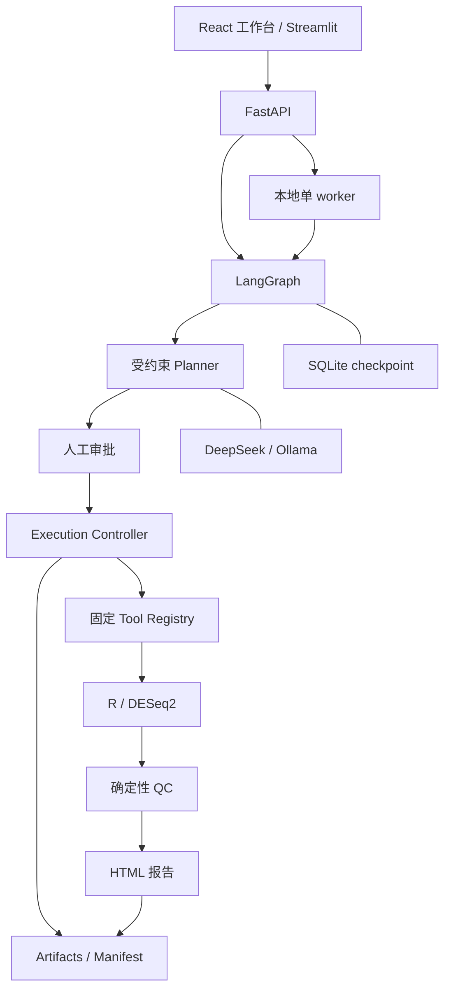

# Bio-Agent

把自然语言比较目标转成需要人工审批的 bulk RNA-seq 双组 DESeq2 分析，并保存可复查的统计结果、QC 和运行证据。


当前 GIF 记录固定 Mock Planner 的上传、待审批状态和断连提示；审批后的录制仍待授权。真实 R/DESeq2 已通过自动端到端测试；完整复现步骤见 [演示指南](docs/demo.md)。

## 核心能力

- 上传一份原始 counts 矩阵，在聊天里确认样本和分组，自动生成 metadata。也支持成对上传 counts 和 metadata。
- 以 Pydantic 约束分析计划；审批绑定计划版本与哈希，修改比较或阈值后重新审批。
- 单个 LangGraph 编排器配合本地单 worker，调用固定 R 入口完成 DESeq2。
- 生成结果表、PCA、样本相关性热图、MA plot、火山图、QC 与 HTML 报告。
- 分离 SQLite 工作流 checkpoint、API 运行索引与科研 manifest；下载时复核产物 SHA-256。
- 提供本地 React 工作台：项目/对话、SSE 消息、人工审批、模型 profile、QC/报告和逐个 artifact 下载。
- 支持按关键词、物种、组织和测序技术搜索 GEO GSE 候选；分页候选必须由用户选择后才检查文件、确认 raw counts 和映射样本。也保留直接输入明确 GSE 编号的路径。
- 将 GEO 来源和搜索证据写入分析 manifest。可选本地知识库支持 PDF 解析、索引、检索和带来源的问答，按需安装。[知识库准备指南](docs/knowledge-ingestion.md)
- 支持本地 Skills 说明、MCP stdio/Streamable HTTP 工具目录、权限策略和一次性人工调用批准；扩展返回不是统计证据。
- Streamlit 经 HTTP API 展示五个页面，运行历史来自项目存储。

## 架构



责任边界、恢复策略和证据结构见 [架构说明](docs/architecture.md)。

GEO 接入从关键词搜索或直接 GSE 到样本映射都需要用户确认；候选分类、分页、资源上限、来源缓存和 provenance 下载规则见 [GEO 数据接入说明](docs/geo.md)。搜索标题和摘要是不可信数据，不能作为 raw counts、统计结果或执行指令。

Skills 与 MCP 仅作为已有单 Agent 工作台的受控扩展，配置、权限、重启恢复和本地只读 fixture 见 [扩展指南](docs/extensions.md)。

## 科学边界

MVP 只接受已计数的 bulk RNA-seq 数据，选定分组列必须恰好有两个水平，每组至少 2 个样本；只有 2 个样本时给出警告。输入应为有限、非负整数 counts，不能用 TPM、FPKM 或已归一化表达量代替。结果的 log2 fold change 始终表示 numerator 相对 denominator。

全零 feature 会移除并留痕；不自动做低表达过滤或改变统计方法。`padj = NA` 会记录而非直接判失败。QC `WARN` 仍可对应运行 `COMPLETED`，需要研究者审阅。当前不支持配对、批次/协变量、交互、时间序列、富集、FASTQ、single-cell 或临床决策。

## 安全边界

模型只规划，不执行任意 Python、R 或 shell。执行层重新校验审批、输入哈希和路径，通过 `shell=False` 参数数组调用固定 R 脚本。上传有扩展名、MIME、大小、表格规模和解析时间限制。

当前为本地单用户应用，没有账户、授权隔离或生产沙盒。取消为协作式，执行中的 R 不保证立即终止。请仅绑定本机地址，并阅读 [安全说明与私密报告方式](SECURITY.md)。

## 快速开始

先安装 Git、uv、Node.js 22.12+ 和 R 4.5.2，并确认 `Rscript` 在 PATH 中。用 Git 克隆项目，分析记录需要 checkout 的提交信息。Windows PowerShell 命令如下，Linux 用户可按安装指南操作。[Windows / Linux 安装指南](docs/getting-started.md)

```powershell
git clone https://github.com/zzj1174949411/bio-agent.git
Set-Location bio-agent
uv python install 3.12
uv sync --frozen
npm --prefix frontend ci
npm --prefix frontend run build
Rscript -e "renv::restore(prompt = FALSE)"
powershell -ExecutionPolicy Bypass -File scripts/start-workbench.ps1
```

打开工作台，在“设置 → 模型与 API”配置自己的模型，然后在聊天输入区选择它。可用仓库中的示例 counts 试跑，或用 GEO 搜索公开矩阵。[本地工作台](http://127.0.0.1:8000/) · [首次分析](docs/getting-started.md#首次分析) · [无需密钥的演示](docs/demo.md)

## 模型与 API 配置

在“已保存模型”下选“新模型”，填名称和下表对应的设置，再点“保存模型”。保存后可以点“探测连接”，随后返回聊天选择该模型。远程 API 使用者各自提供服务商颁发的密钥，页面将密钥保存到运行应用的系统凭据库。

| 接口协议 | API Base URL | 模型 ID | API Key |
| --- | --- | --- | --- |
| DeepSeek | `https://api.deepseek.com` | `deepseek-flash` | 你的 DeepSeek Key |
| OpenAI 兼容 Chat Completions | 服务商提供的 API 根地址，通常以 `/v1` 结尾 | 服务商提供的 ID | 你的服务商 Key |
| Ollama | `http://localhost:11434` | 已下载的本地模型，例如 `qwen3:8b` | 留空 |

页面配置即时生效。没有可用的系统凭据库时，可使用本机 `.env` 的 DeepSeek 环境配置。旧 Streamlit 与无模型配置的 API 也使用环境配置，修改后需重启服务。[模型与凭据配置](docs/getting-started.md#配置模型) · [DeepSeek 模型列表](https://api-docs.deepseek.com/api/list-models/) · [Ollama 快速开始](https://docs.ollama.com/quickstart)

| 配置 | 默认值 / 用途 |
| --- | --- |
| `BIOAGENT_LLM_PROVIDER` | `deepseek`；可改为 `ollama` |
| `BIOAGENT_DEEPSEEK_API_KEY` | 仅在本地填写，不进入 Git |
| `BIOAGENT_DEEPSEEK_BASE_URL` | `https://api.deepseek.com` |
| `BIOAGENT_DEEPSEEK_MODEL` | 示例配置为 `deepseek-flash` |
| `BIOAGENT_OLLAMA_BASE_URL` | `http://localhost:11434` |
| `BIOAGENT_OLLAMA_MODEL` | `qwen3:8b` |
| `BIOAGENT_API_BASE_URL` | UI 请求的 API 地址，默认 `http://localhost:8000` |

DeepSeek 通过 OpenAI 兼容客户端接入，旧环境工厂固定 60 秒超时、最多 2 次客户端重试；页面配置适配器不做客户端自动重试；规划器显式使用 function calling 返回计划，DeepSeek 请求关闭思考模式以支持强制选择计划工具，返回参数仍由本地 schema 和数据语义校验。计划 schema 校验失败最多修正 1 次。模型名称和服务能力以 [DeepSeek 官方文档](https://api-docs.deepseek.com/) 为准。Ollama 需自行安装服务和下载对应模型，见 [官方快速开始](https://docs.ollama.com/quickstart)；接入边界已有 Mock 测试，本地模型行为需单独验收。

默认 API 使用确定性报告；报告模块的可选 LLM 叙述器未默认启用。外部模型只接收目标和受约束数据摘要，不接收完整 counts，但目标和组名仍可能包含敏感信息。

## 运行测试

Windows 全量门禁：

```powershell
powershell -ExecutionPolicy Bypass -File scripts/check.ps1
uv run pre-commit run --all-files
```

Linux 分步命令见 [安装指南中的验证步骤](docs/getting-started.md#运行检查)。测试覆盖审批前零执行、恶意输入、路径和哈希、恢复与取消、Mock Agent eval，以及真实 DESeq2 统计方向和产物。测试不要求模型 Key。

[GitHub Actions 配置](.github/workflows/ci.yml) 包含 Windows/Ubuntu Python 检查与 Ubuntu R/端到端检查；实际发布验证记录见 [当前进度](docs/progress/current-state.md)，本地通过不代表远端 CI 已通过。

## 示例产物

使用 [counts fixture](tests/fixtures/counts_deseq2.csv) 和 [metadata fixture](tests/fixtures/metadata_deseq2.csv)，审批 `AD / Control` 比较后，当前 attempt 产生：

| 产物 | 内容 |
| --- | --- |
| `results/all_results.csv`、`significant_results.csv` | 全部结果与按批准 alpha 筛选的显著子集 |
| `normalized_counts.csv`、`pca.csv`、`size_factors.csv` | 归一化 counts、PCA 坐标、size factors |
| `figures/*.png`、`figures/*.pdf` | PCA、样本相关性热图、MA plot、火山图 |
| `execution_summary.json`、`session_info.txt` | 结构化执行摘要和实际 R 会话版本 |
| `qc.json`、`logs/stdout.log`、`logs/stderr.log` | QC 和执行诊断 |
| `report/report.html`、`manifest.json` | 可离线查看的报告与运行证据 |
| `input/counts.csv`、`input/metadata.csv`、`plans/plan-v1.json` | 原始输入快照与获批计划（输入也可为 TSV） |

API 提供逐个 artifact 下载，包含登记的输入快照、计划、结果与报告，并提供 manifest 下载；没有 ZIP 端点。按 [演示指南](docs/demo.md) 下载文件、保留相对路径并核对全部 SHA-256，即可整理完整离线目录。分析数据和运行产物不会提交到仓库。

启用 apeglm 收缩时，`log2FoldChange` 是收缩后的效应量，`lfcSE` 是后验标准差；`stat`、`pvalue`、`padj` 保留原始 Wald 检验结果和批准 alpha 对应的独立过滤结果。此时 `stat` 不是收缩后 `log2FoldChange / lfcSE` 的比值。[DESeq2 作者关于收缩与 stat 的说明](https://support.bioconductor.org/p/129277/)

## 路线图

当前 MVP 聚焦双组 DESeq2。后续按独立设计与验收逐步考虑协变量和 edgeR 对照、GO/KEGG、single-cell、FASTQ/Nextflow 与容器化；多 Agent 运行时不在当前范围。详见 [已批准设计](docs/superpowers/specs/2026-08-15-bio-agent-design.md)。

## 许可证

项目代码采用 [MIT License](LICENSE)。R、Bioconductor 及其他依赖遵循各自许可证。
