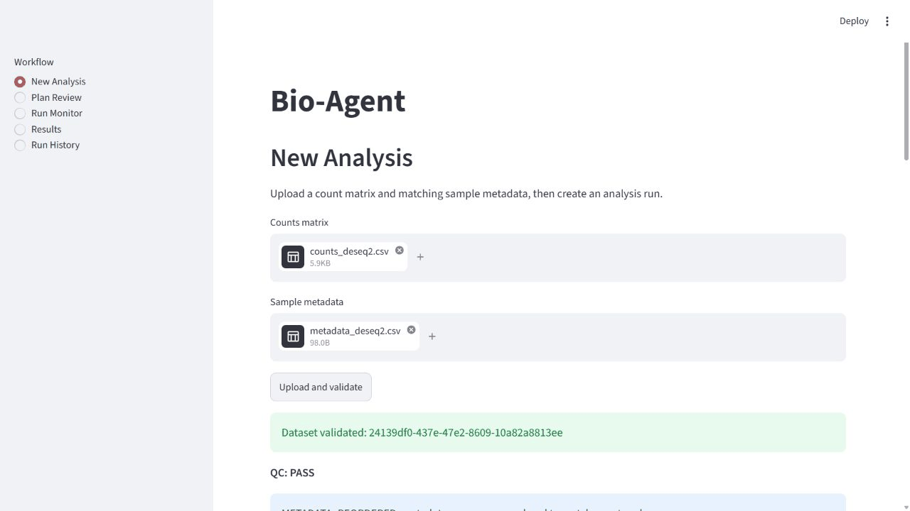
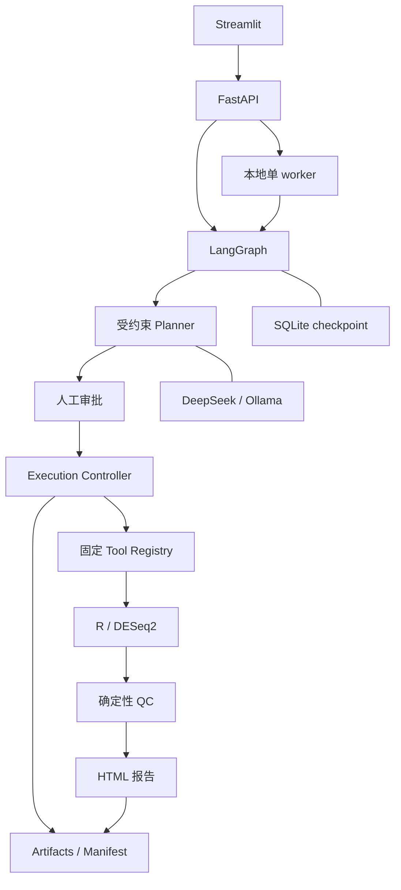

# Bio-Agent

把自然语言比较目标转成需要人工审批的 bulk RNA-seq 双组 DESeq2 分析，并保存可复查的统计结果、QC 和运行证据。



当前 GIF 记录固定 Mock Planner 的上传、待审批状态和断连提示；审批后的录制仍待授权。真实 R/DESeq2 已通过自动端到端测试；完整复现步骤见 [演示指南](docs/demo.md)。

## 核心能力

- 校验 CSV/TSV 原始 counts 和 metadata，明确返回错误、警告与自动重排记录。
- 以 Pydantic 约束分析计划；审批绑定计划版本与哈希，修改比较或阈值后重新审批。
- 单个 LangGraph 编排器配合本地单 worker，调用固定 R 入口完成 DESeq2。
- 生成结果表、PCA、样本相关性热图、MA plot、火山图、QC 与 HTML 报告。
- 分离 SQLite 工作流 checkpoint、API 运行索引与科研 manifest；下载时复核产物 SHA-256。
- 提供本地 React 工作台：项目/对话、SSE 消息、人工审批、模型 profile、QC/报告和逐个 artifact 下载。
- 支持从单个 GSE 编号发现 GEO 候选、确认 raw counts、映射样本并把来源副本绑定到分析 manifest。
- 支持本地 Skills 说明、MCP stdio/Streamable HTTP 工具目录、权限策略和一次性人工调用批准；扩展返回不是统计证据。
- Streamlit 经 HTTP API 展示五个页面，运行历史来自项目存储。

## 架构



责任边界、恢复策略和证据结构见 [架构说明](docs/architecture.md)。

GEO 接入从候选发现到样本映射都需要用户确认；候选分类、资源上限、来源缓存和 provenance 下载规则见 [GEO 数据接入说明](docs/geo.md)。

Skills 与 MCP 仅作为已有单 Agent 工作台的受控扩展，配置、权限、重启恢复和本地只读 fixture 见 [扩展指南](docs/extensions.md)。

## 科学边界

MVP 只接受已计数的 bulk RNA-seq 数据，选定分组列必须恰好有两个水平，每组至少 2 个样本；只有 2 个样本时给出警告。输入应为有限、非负整数 counts，不能用 TPM、FPKM 或已归一化表达量代替。结果的 log2 fold change 始终表示 numerator 相对 denominator。

全零 feature 会移除并留痕；不自动做低表达过滤或改变统计方法。`padj = NA` 会记录而非直接判失败。QC `WARN` 仍可对应运行 `COMPLETED`，需要研究者审阅。当前不支持配对、批次/协变量、交互、时间序列、富集、FASTQ、single-cell 或临床决策。

## 安全边界

模型只规划，不执行任意 Python、R 或 shell。执行层重新校验审批、输入哈希和路径，通过 `shell=False` 参数数组调用固定 R 脚本。上传有扩展名、MIME、大小、表格规模和解析时间限制。

当前为本地单用户应用，没有账户、授权隔离或生产沙盒。取消为协作式，执行中的 R 不保证立即终止。请仅绑定本机地址，并阅读 [安全说明与私密报告方式](SECURITY.md)。

## 快速开始

先按 [Windows / Linux 安装指南](docs/getting-started.md) 安装 uv、Node 22.12+、Python 3.12、R 4.5.2 并恢复 renv。构建并启动本地 Web 工作台的完整说明见 [工作台指南](docs/workbench.md)。以下命令在仓库根目录的 PowerShell 中执行：

```powershell
uv sync --frozen --dev
npm --prefix frontend ci
npm --prefix frontend run build
Rscript -e "renv::restore(prompt = FALSE)"
Copy-Item .env.example .env
$env:R_LIBS = (Rscript -e 'cat(renv::paths$library())' | Select-Object -Last 1).Trim()
uv run uvicorn bioagent.api.app:create_app --factory --reload --host 127.0.0.1
```

启动 API 前，在本地 `.env` 配置模型；没有 Key 时使用 [Mock 演示工厂](docs/demo.md)。扩展设置和本地只读 MCP fixture 不要求模型 Key。已有 `.env` 时保留自己的配置，不重复复制。另开一个终端，在同一仓库运行：

```powershell
uv run streamlit run ui/streamlit_app.py --server.address 127.0.0.1
```

打开 [React 工作台](http://localhost:8000/)、[旧 Streamlit 界面](http://localhost:8501) 或 [OpenAPI 文档](http://localhost:8000/docs)。`/health` 表示进程在线；`/ready` 检查依赖初始化，不等于真实模型请求或完整 DESeq2 分析已通过。

## DeepSeek / Ollama 配置

当前交付先使用 Mock Planner 验证完整本地流程，真实模型 API 联调由用户后续进行，不是本阶段的阻塞项。无需 Key 的启动步骤见 [Mock 演示指南](docs/demo.md)；接入真实模型时使用下面的配置。

配置从环境变量或仓库根目录 `.env` 加载，示例在 [.env.example](.env.example)。

| 配置 | 默认值 / 用途 |
| --- | --- |
| `BIOAGENT_LLM_PROVIDER` | `deepseek`；可改为 `ollama` |
| `BIOAGENT_DEEPSEEK_API_KEY` | 仅在本地填写，不进入 Git |
| `BIOAGENT_DEEPSEEK_BASE_URL` | `https://api.deepseek.com` |
| `BIOAGENT_DEEPSEEK_MODEL` | `deepseek-v4-flash` |
| `BIOAGENT_OLLAMA_BASE_URL` | `http://localhost:11434` |
| `BIOAGENT_OLLAMA_MODEL` | `qwen3:8b` |
| `BIOAGENT_API_BASE_URL` | UI 请求的 API 地址，默认 `http://localhost:8000` |

DeepSeek 通过 OpenAI 兼容客户端接入，当前工厂固定 60 秒超时、最多 2 次客户端重试；规划器显式使用 function calling 返回计划，DeepSeek 请求关闭思考模式以支持强制选择计划工具，返回参数仍由本地 schema 和数据语义校验。计划 schema 校验失败最多修正 1 次。模型名称和服务能力以 [DeepSeek 官方文档](https://api-docs.deepseek.com/) 为准。Ollama 需自行安装服务和下载对应模型，见 [官方快速开始](https://docs.ollama.com/quickstart)；接入边界已有 Mock 测试，本地模型行为需单独验收。

默认 API 使用确定性报告；报告模块的可选 LLM 叙述器未默认启用。外部模型只接收目标和受约束数据摘要，不接收完整 counts，但目标和组名仍可能包含敏感信息。

## 运行测试

Windows 全量门禁：

```powershell
powershell -ExecutionPolicy Bypass -File scripts/check.ps1
uv run pre-commit run --all-files
```

Linux 分步命令见 [安装指南中的验证步骤](docs/getting-started.md#运行检查)。测试覆盖审批前零执行、恶意输入、路径和哈希、恢复与取消、Mock Agent eval，以及真实 DESeq2 统计方向和产物。测试不要求模型 Key。

[GitHub Actions 配置](.github/workflows/ci.yml) 包含 Windows/Ubuntu Python 检查与 Ubuntu R/端到端检查；实际发布验证记录见 [当前进度](docs/progress/current-state.md)，本地通过不代表远端 CI 已通过。

## 示例产物

使用 [counts fixture](tests/fixtures/counts_deseq2.csv) 和 [metadata fixture](tests/fixtures/metadata_deseq2.csv)，审批 `AD / Control` 比较后，当前 attempt 产生：

| 产物 | 内容 |
| --- | --- |
| `results/all_results.csv`、`significant_results.csv` | 全部结果与按批准 alpha 筛选的显著子集 |
| `normalized_counts.csv`、`pca.csv`、`size_factors.csv` | 归一化 counts、PCA 坐标、size factors |
| `figures/*.png`、`figures/*.pdf` | PCA、样本相关性热图、MA plot、火山图 |
| `execution_summary.json`、`session_info.txt` | 结构化执行摘要和实际 R 会话版本 |
| `qc.json`、`logs/stdout.log`、`logs/stderr.log` | QC 和执行诊断 |
| `report/report.html`、`manifest.json` | 可离线查看的报告与运行证据 |
| `input/counts.csv`、`input/metadata.csv`、`plans/plan-v1.json` | 原始输入快照与获批计划（输入也可为 TSV） |

API 提供逐个 artifact 下载，包含登记的输入快照、计划、结果与报告，并提供 manifest 下载；没有 ZIP 端点。按 [演示指南](docs/demo.md) 下载文件、保留相对路径并核对全部 SHA-256，即可整理完整离线目录。分析数据和运行产物不会提交到仓库。

启用 apeglm 收缩时，`log2FoldChange` 是收缩后的效应量，`lfcSE` 是后验标准差；`stat`、`pvalue`、`padj` 保留原始 Wald 检验结果和批准 alpha 对应的独立过滤结果。此时 `stat` 不是收缩后 `log2FoldChange / lfcSE` 的比值。[DESeq2 作者关于收缩与 stat 的说明](https://support.bioconductor.org/p/129277/)

## 路线图

当前 MVP 聚焦双组 DESeq2。后续按独立设计与验收逐步考虑协变量和 edgeR 对照、GO/KEGG、single-cell、FASTQ/Nextflow 与容器化；多 Agent 运行时不在当前范围。详见 [已批准设计](docs/superpowers/specs/2026-08-15-bio-agent-design.md)。

## 许可证

项目代码采用 [MIT License](LICENSE)。R、Bioconductor 及其他依赖遵循各自许可证。
