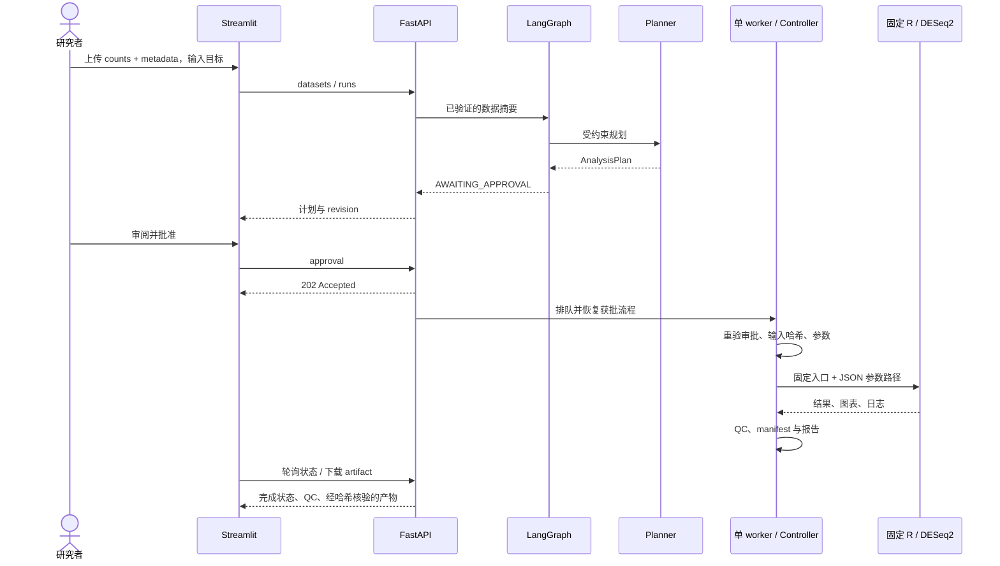
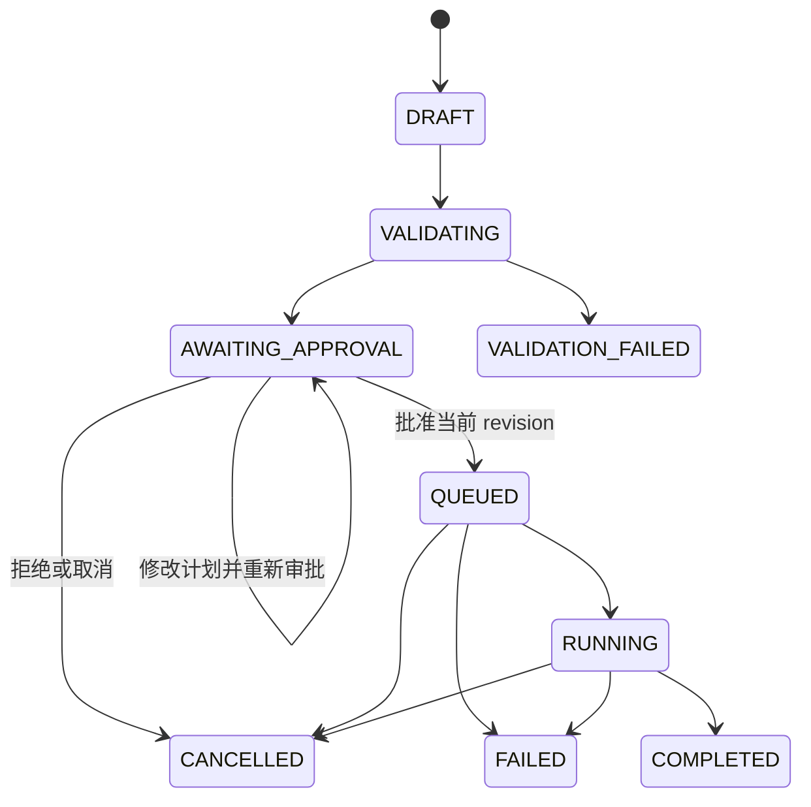

# 架构与证据边界

Bio-Agent 是本地单用户、单 LangGraph 编排器的 bulk RNA-seq 双组分析应用。LLM 提出受约束计划，确定性代码决定输入是否有效、计划能否执行以及结果是否合格；研究者批准科学参数。设计基线见 [已批准规格](superpowers/specs/2026-08-15-bio-agent-design.md)。

## 组件责任

| 组件 | 责任与边界 |
| --- | --- |
| `frontend/` | React/TypeScript 同源工作台；只通过 REST/SSE 访问 API，负责项目/对话、模型设置、审批卡、QC/报告和 artifact 下载 |
| `ui/streamlit_app.py` | 保留的旧 HTTP 客户端，通过 API 上传、审批、轮询、查看结果与项目历史；不直接调用 graph 或 RRunner |
| `api/` | FastAPI 应用工厂、依赖装配、上传限制、run 索引、审批、不透明 artifact ID 下载，以及生产静态资源和前端路由回退 |
| `datasets/` | CSV/TSV 解析、ID/数值/样本/分组校验；每次读取重新核对输入 SHA-256 |
| `llm/` | DeepSeek/Ollama 模型工厂与结构化 Planner；只接收目标和最小数据摘要 |
| `workflow/` | 规划、人工审批 interrupt、执行和 QC 路由；科学参数修订后重新审批 |
| `execution/job_runner.py` | 进程内单 worker，隔离长任务与 HTTP 请求，执行去重及协作式取消 |
| `execution/controller.py` | 重验审批 revision/hash、输入、环境与幂等证据，创建独立 attempt 并留存 provenance |
| `tools/`、`tool_specs/deseq2.yaml` | 固定工具注册表、参数适配与输出契约，不接受用户指定脚本 |
| `execution/r_runner.py`、`r/deseq2/` | 参数数组、固定 R 入口、独立工作目录、超时、日志；DESeq2 统计与绘图 |
| `reporting/` | 从已验证 artifact 构建摘要，使用自动转义模板生成确定性 HTML；可选叙述器受事实句式约束 |
| `geo/` | NCBI GEO 元数据发现、受限下载、显式样本映射、来源缓存和 source/dataset 绑定 |
| `extensions/` | 本地 Skill 快照、MCP stdio/Streamable HTTP 适配、工具 schema/policy、一次性批准和不可信结果摘要 |
| `artifacts/`、`storage/` | 受控路径、manifest 原子写入、独立 SQLite checkpoint 与 API run 索引 |



Planner 输出必须通过 `AnalysisPlan` schema 和真实 metadata 语义校验。`factor` 来自真实列，两个比较水平来自该列，公式由固定 R 代码以内部列名构建。把一个模型称作“可信”并不构成执行授权，真正的权限边界是 Controller 对审批和数据契约的重验。

## 状态与审批



图省略了 `DRAFT` 和 `VALIDATING` 的取消路径。运行状态与科学 QC 分开保存：`PASS` 为通过，`WARN` 为需审阅的证据，`FAIL` 阻止成功完成。`COMPLETED + WARN` 是有效组合，不能把警告视为无条件成功或擅自改变分析策略。

批准记录绑定 `plan_revision`、规范化 `plan_hash`、决定时间和 actor；本地 MVP 的 actor 是审计标签，不是经过身份认证的用户。修订比较方向、分组、alpha、shrink 等参数会清除旧审批，不能用旧 revision 批准新计划。审批前测试要求 R 调用次数为 0。

队列取消可以阻止尚未开始的任务；运行中取消通过回调在边界检查，当前 `subprocess.run()` 中的 R 不保证立即终止。DESeq2 ToolSpec 设置 1,800 秒超时。`memory_mb: 4096` 是工具元数据，当前没有操作系统级内存强制隔离。

## 幂等、恢复与失败

execution key 结合 run、计划和输入哈希，在途任务由本地 runner 去重。执行层在相同 run 中发现完整、哈希正确且语义一致的完成证据时复用结果；跨 run 不做全局缓存。缺失或被篡改的产物不能作为成功依据，重新执行会创建独立 attempt。

checkpoint 可以恢复 LangGraph 编排状态，不能证明外部 R 进程仍在执行。API 重启时检查原 QUEUED/RUNNING 索引：若有有效完成 manifest 和登记产物则恢复完成态，否则记为失败。遗留执行记录保留，不把内存队列当成持久队列，不承诺重启后自动继续 R。

schema 失败最多请求模型修正 1 次；DeepSeek 客户端当前最多重试 2 次。统计错误不会自动切换到 edgeR 或 limma。失败、取消和恢复保留 attempt 与诊断，不能把不完整产物包装成成功分析。

## 三类存储

| 存储 | 用途 | 不能替代的证据 |
| --- | --- | --- |
| `checkpoints.sqlite` | LangGraph 节点状态与审批中断恢复 | 不能证明 R 成功或产物未被修改 |
| `runs/<run_id>/run.json` | API 查询索引和项目运行历史 | 查询状态不能替代 manifest/产物核验 |
| `runs/<run_id>/manifest.json` 与产物 | 科研参数、审批、输入及产物哈希、attempt 和 QC | 不依赖 LangGraph 格式，但 SHA-256 不是数字签名 |

默认数据集原始上传保存在 `data/` 下的内部 UUID 目录；GEO 来源保存在独立的 `data/sources/` 缓存，执行时将选定来源和 dataset 输入复制进该 run 的受控目录。目录概况如下：

```text
runs/<run_id>/
├── run.json
├── input/
│   ├── counts.csv                  # 或 .tsv
│   └── metadata.csv                # 或 .tsv
├── plans/plan-v1.json
├── attempts/<attempt_id>/
│   ├── parameters.json
│   ├── attempt.json
│   ├── results/
│   ├── figures/
│   ├── logs/
│   └── qc.json
├── report/report.html
├── source/
│   ├── raw/source.bin
│   ├── source.json
│   └── normalized/{counts.csv,metadata.csv}
└── manifest.json
```

manifest 保存 run/dataset/attempt ID、批准的 revision/hash、输入 SHA-256、工具、Git commit、比较方向、alpha、shrink、随机种子、时间、状态、QC、审批记录及产物相对路径与哈希。若分析来自 GEO，manifest 还保存来源 ID 和 source artifact 记录；旧的无来源 manifest 仍可读取。当前默认 API 的 `software_versions` 取自 `renv.lock` 中的 R/DESeq2 版本；实际加载的 R 和包版本记录在 `results/session_info.txt`，复现时需一起检查。Git commit 也不能表示工作区未提交改动，因此发布演示要记录实际 checkout 状态。

输入哈希针对原始文件字节；metadata 重排与全零 feature 移除是确定性步骤并记录 QC 事件。跨操作系统复现重点是统计结果及其数值容差，不能要求带运行时间、UUID 的 manifest 或图像文件跨次运行逐字节相同。

## 下载与报告

完成态下载通过 `GET /api/v1/runs/{run_id}/artifacts` 列出系统生成的 ID，再通过 `GET /api/v1/runs/{run_id}/artifacts/{artifact_id}` 获取文件。文件路径不是客户端授权凭据；服务器根据登记信息解析路径并重新计算哈希。manifest 自身作为下载项提供，其字节哈希在下载列表中返回，不在 manifest 内形成自引用哈希。

Controller 将输入快照和获批计划也登记在 `manifest.artifacts`，因此 `input/counts.csv`、`input/metadata.csv`（或 TSV）以及 `plans/plan-v<revision>.json` 都可经 artifact API 下载。API 没有 ZIP 端点；完整离线包应按 [演示指南](demo.md) 下载全部登记产物和 manifest、保持相对路径，并核验产物及输入哈希。报告中的图链接依赖这种目录结构。

报告节点将 manifest 与当前工作流的 run、dataset、attempt、plan revision、规范化 plan hash 和 QC 逐项核对，并重新验证全部登记产物的 SHA-256。只有证据匹配才从当前 attempt 的结果构建 HTML，再将报告登记回 manifest。身份或证据失配、生成或写入失败均返回 `FAILED` 与 `REPORT_FAILED`，不会完成成功报告路径。

GEO 来源在创建 run 时完成 source/dataset 一致性检查并复制；R 执行前、完成态复用和 API 重启恢复都会重算来源文件哈希。来源缓存或 run 副本被篡改时，执行会拒绝复用并保留诊断。下载 API 只接受由 manifest 记录计算出的不透明 artifact ID。

默认 API 生成确定性 HTML。报告模块另有可选 LLM 叙述器，但默认依赖装配不启用它；它仅允许基于已验证摘要的规定事实句式，不允许补充统计数字、未执行方法或临床/因果结论。LLM 不可用不会使确定性报告失去统计内容。

## 验证依据与当前限制

`tests/unit/` 验证契约与安全边界；`tests/integration/` 验证 API、checkpoint、MCP transport 和 RRunner；`tests/evals/` 使用固定 Mock 场景验证规划策略；`tests/e2e/` 包含本地 MCP stdio/HTTP、批准重启恢复、真实 DESeq2 与恢复验收；`frontend/e2e/` 只使用本地 route fixture 验收设置入口。具体结果及尚未通过的发布验收在 [当前进度](progress/current-state.md)，不从配置文件推断远端 CI 已通过。

MVP 不包含账户、团队授权、分布式队列、容器沙盒、多因素分析或多 Agent 运行时。扩展必须继续经过类型契约、人工审批、固定工具、QC 和 provenance 边界；MCP 结果不改变统计状态，重启/取消也不自动重发可能已有远端副作用的调用。
