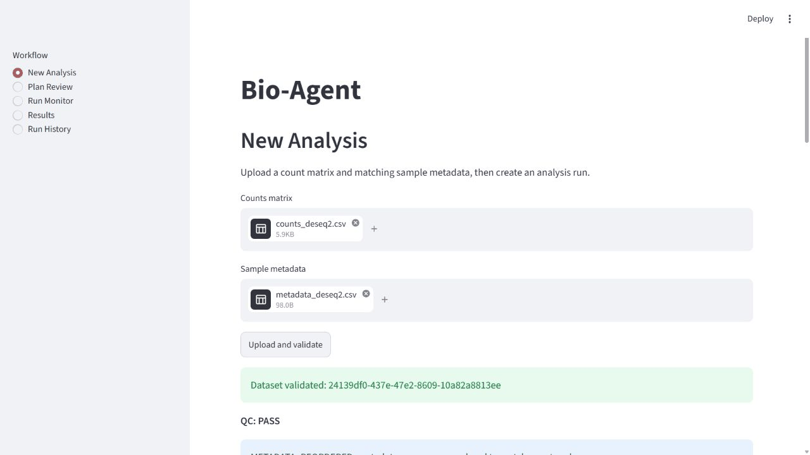

# 固定数据演示与发布验收

演示范围：200 个模拟 feature、6 个样本（AD/Control 各 3 个），使用仓库
`tests/fixtures/counts_deseq2.csv` 和 `metadata_deseq2.csv`，不含患者数据。
metadata 顺序故意不同，上传后应看到 `METADATA_REORDERED`。



当前 GIF 是上传、计划审阅、待审批、历史和断连错误的真实浏览器关键帧；审批后画面尚待这次具体人工授权。完整演示使用固定 Mock Planner 和真实 R/DESeq2；后者已在自动测试执行。GIF 不代表 DeepSeek 的理解能力，也不是连续实时录屏。
本阶段先验收 Mock 规划器与本地完整流程；真实模型 API 联调按用户 2026-09-08 的决定延后。各项验收的实际结果见 [进度记录](progress/current-state.md)。

## 无 DeepSeek Key 的完整演示

先完成 [安装和 renv 恢复](getting-started.md)，在启动 API 的终端导出 `R_LIBS`。
默认 API 不会在缺少 Key 时自动切换 Mock。将下面受信任的演示代码保存为
`runs/demo_app.py`（先创建 `runs` 目录；该目录已被 Git 忽略）：

```python
from pathlib import Path

from bioagent.api.app import create_app
from bioagent.config import Settings
from bioagent.domain.plans import AnalysisPlan


class FixturePlanner:
    def plan(self, *, user_goal, summary):
        if user_goal != "Compare AD with Control":
            raise ValueError("This demo only accepts: Compare AD with Control")
        if (set(summary.categorical_levels) != {"condition"}
                or set(summary.categorical_levels["condition"]) != {"AD", "Control"}):
            raise ValueError("Use the documented fixture")
        return AnalysisPlan.model_validate({
            "dataset_id": summary.dataset_id,
            "comparison": {
                "factor": "condition", "numerator": "AD", "denominator": "Control",
            },
            "options": {"alpha": 0.05, "lfc_shrink": False, "random_seed": 42},
        })


def create_demo_app():
    root = Path("runs/demo")
    return create_app(
        Settings(_env_file=None, deepseek_api_key=None,
                 data_dir=root / "data", runs_dir=root / "runs",
                 checkpoint_db=root / "checkpoints.sqlite"),
        overrides={"planner": FixturePlanner()},
    )
```

这段代码只替换 Planner，保留真实 API、输入校验、LangGraph、SQLite、审批、Controller、
RRunner、QC 和报告。固定计划仍会经过工作流的 schema 和数据语义校验。
`lfc_shrink=False` 是演示时明确审阅的选项；不要据此推断所有科学问题都应关闭 shrink。

在根目录启动，两个终端分别运行：

```powershell
uv run uvicorn demo_app:create_demo_app --app-dir runs --factory --host 127.0.0.1
```

```powershell
uv run streamlit run ui/streamlit_app.py --server.address 127.0.0.1 --browser.gatherUsageStats false
```

Linux 使用同样的两条命令。端口冲突时，可分别增加 `--port 8015` 和
`--server.port 8515`，并为 UI 设置 `BIOAGENT_API_BASE_URL=http://localhost:8015`。

1. 打开 UI 的 **New Analysis**，分别上传两个 fixture，点击 **Upload and validate**。
2. 确认 QC 和 200 feature / 6 sample 摘要；填写精确目标 `Compare AD with Control`，
   点击 **Create analysis run**。
3. 在 **Plan Review** 审阅 `AD relative to Control`、`condition`、alpha 0.05、
   shrink false、seed 42 和 revision 1。此时尚无 R attempt。
4. 点击 **Approve plan**。若改方向或阈值，用 **Modify plan** 提交后重新审阅新 revision。
5. 到 **Run Monitor** 点击 **Refresh status**，等待 `COMPLETED`，审阅 QC；刷新是手动轮询。
6. **Results** 展示表格下载、四类 PNG/PDF 图、日志、HTML 与 manifest 下载。
   HTML 的图和下载链接是相对路径：在下面导出的目录包中打开 `report/report.html`，
   可完整浏览关联文件；UI 中另有 PNG 预览，iframe 不作为完整目录包。
7. **Run History** 可重新选择该 run。保留 run ID，按下一节导出。

## 下载到新临时目录并核对 SHA-256

API 提供逐个 artifact 下载，没有 ZIP 端点。下面的维护者脚本通过不透明 ID 下载全部
登记文件（含输入、计划、当前及仍完整的历史 attempt、报告），按 manifest 相对路径重建目录。
manifest 自身的哈希来自 API 列表，避免在 manifest 中保存自哈希形成循环。
这能检测字节变化；未经签名的 manifest 不是对恶意本机管理员的密码学证明。

将以下代码保存为 `runs/download_demo.py`。只对自己的本地 API 使用，参数为 UI 的 run ID：

```python
import json
import sys
import tempfile
from hashlib import sha256
from pathlib import Path
from uuid import UUID

import httpx

from bioagent.artifacts.manifest import RunManifest

run_id = str(UUID(sys.argv[1]))
base_url = sys.argv[2] if len(sys.argv) > 2 else "http://localhost:8000"
root = Path(tempfile.mkdtemp(prefix="bio-agent-download-"))
with httpx.Client(base_url=base_url, timeout=30) as client:
    listed = client.get(f"/api/v1/runs/{run_id}/artifacts")
    listed.raise_for_status()
    blobs = {}
    manifest_bytes = None
    for item in listed.json()["artifacts"]:
        response = client.get(f"/api/v1/runs/{run_id}/artifacts/{item['artifact_id']}")
        response.raise_for_status()
        assert sha256(response.content).hexdigest() == item["sha256"], "API hash mismatch"
        blobs[item["artifact_id"]] = response.content
        if 'filename="manifest.json"' in response.headers.get("content-disposition", ""):
            manifest_bytes = response.content
    assert manifest_bytes is not None, "manifest download missing"
    manifest = RunManifest.model_validate_json(manifest_bytes)
    assert str(manifest.run_id) == run_id
    (root / "manifest.json").write_bytes(manifest_bytes)
    for item in manifest.artifacts:
        artifact_id = sha256(f"{item.relative_path}\0{item.sha256}".encode()).hexdigest()
        content = blobs[artifact_id]
        assert sha256(content).hexdigest() == item.sha256, "manifest hash mismatch"
        target = (root / item.relative_path).resolve()
        assert root.resolve() in target.parents, "path outside download directory"
        target.parent.mkdir(parents=True, exist_ok=True)
        target.write_bytes(content)
    for label, digest in manifest.input_hashes.items():
        inputs = list((root / "input").glob(f"{label}.*"))
        assert len(inputs) == 1 and sha256(inputs[0].read_bytes()).hexdigest() == digest
    for item in manifest.artifacts:
        assert sha256((root / item.relative_path).read_bytes()).hexdigest() == item.sha256
    assert (root / "report/report.html").is_file()
print(json.dumps({"directory": str(root), "artifacts_verified": len(manifest.artifacts),
                  "inputs_verified": len(manifest.input_hashes), "manifest_verified": True}))
```

```powershell
uv run python runs/download_demo.py YOUR_RUN_UUID
```

只有所有断言通过才算该项验收通过。任一下载 409、缺失或哈希不符都应保留现场，
不标记完整包成功。报告发布会验证全部登记证据；旧 attempt 证据损坏也会阻止报告发布，
即使统计层成功重跑。此时应调查损坏，必要时用原始输入创建新的 run，不删除历史审计。

## 其余真实手工验收

**真实 DeepSeek 计划（用户后续接入，本阶段不要求）：** 在本地 `.env` 配置 `BIOAGENT_DEEPSEEK_API_KEY`，使用默认
`bioagent.api.app:create_app` 启动 API。上传同一 fixture，以自然语言请求 AD 相对 Control。
确认 `/plan` 返回合法结构化计划、真实 factor/levels、正确方向与 `AWAITING_APPROVAL`。
不要点击批准也应保持零 attempt。只记录模型名、日期、run ID 和检查结论；不记录请求凭据。
无 Key、网络错误或模型拒绝都不能写成通过；Mock 通过不能替代此项。

**后端关闭：** 保持 UI 打开，在启动 API 的终端按 Ctrl+C，进入 **Run History** 或刷新
**Run Monitor**。应显示 `Cannot reach the Bio-Agent API. Check that the backend is running.`。
重新启动对应 API 后刷新，应能继续查看已保存运行。

## GIF 录制与重建

使用 1280×720 浏览器视窗，按上述真实流程分别截取：上传验证、计划审阅、运行完成、
PCA、HTML/manifest 下载、后端断开错误。截图保存为 `runs/demo-frames/01-upload.png`
等有序 PNG；只录公开 fixture，不录 `.env`、终端凭据、患者数据或私人浏览器标签。
此仓库的 GIF 由这些实际 UI 关键帧编码，未生成模拟界面。

将下列编码代码保存为 `runs/encode_demo.py`。Pillow 是录制辅助库，不加入应用依赖：

```python
from pathlib import Path
from PIL import Image

paths = sorted(Path("runs/demo-frames").glob("*.png"))
assert len(paths) >= 5
frames = [Image.open(path).convert("RGB") for path in paths]
assert len({frame.size for frame in frames}) == 1
Path("docs/assets").mkdir(parents=True, exist_ok=True)
frames[0].save("docs/assets/demo.gif", save_all=True, append_images=frames[1:],
               duration=2500, loop=0, optimize=True)
```

```powershell
uv run --with pillow python runs/encode_demo.py
git diff --check
```

只提交 `docs/assets/demo.gif`；PNG 原帧、运行目录和下载包不提交。
