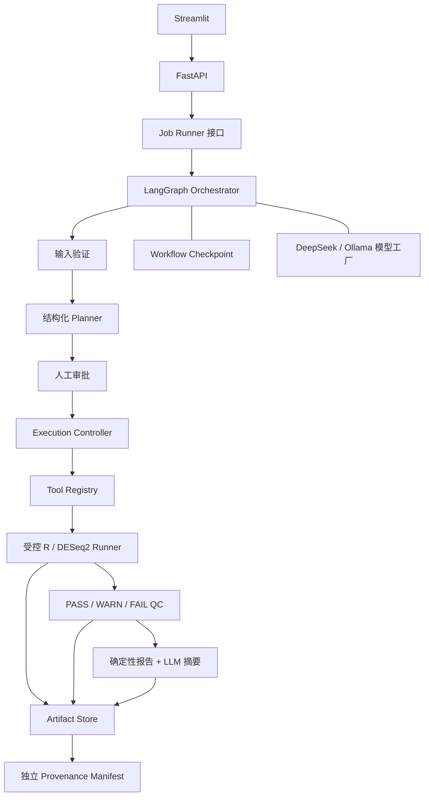

# Bio-Agent MVP 设计规格

**状态：** 已确认

**日期：** 2026-08-15

**目标周期：** 8 周

## 1. 项目目标

构建一个可靠、可扩展、可审计的生物信息学 Agent。第一版聚焦 bulk RNA-seq 双组差异表达分析，展示通用 Agent 工程能力与真实生信分析能力。

系统接收 count matrix、样本 metadata 和自然语言分析目标，生成结构化 DESeq2 分析计划。用户批准后，系统调用确定性 R 工具完成分析、质量控制、图表与报告，并保存可复现的运行记录。

第一版成功标准：

> 用户上传有效的 bulk RNA-seq count matrix 和 metadata，系统生成结构化 DESeq2 计划并请求审批；获批后完成分析，返回结果、图表、QC、日志、HTML 报告和可复现 manifest。未经批准的计划不得执行。

## 2. 设计原则

1. LLM 负责理解、规划和解释；确定性代码负责统计计算和校验。
2. 科学决策需要人工审批，低风险操作性修复可以有限自动化。
3. 计划、工具参数和结果都使用强类型数据契约。
4. 工作流状态与科研运行历史分离。
5. 每次运行都保留输入哈希、参数、版本、日志、QC 和产物。
6. 可复现性、可审计性和安全性优先于最大自主性。
7. 第一版使用单个 LangGraph 编排器，不引入多 Agent。
8. MVP 只实现已确认的必要功能，扩展通过稳定接口逐步加入。

## 3. MVP 范围

### 3.1 包含功能

- 上传 counts CSV/TSV 和 metadata CSV/TSV。
- 确定性输入验证与数据概况。
- 自然语言目标转强类型分析计划。
- 分析计划的批准、修改和拒绝。
- 后台调用 R/DESeq2。
- 运行后确定性 QC。
- PCA、样本相关性热图、MA plot 和火山图。
- 结果表、日志、HTML 报告和 manifest。
- LangGraph checkpoint 与安全恢复。
- DeepSeek API，保留 Ollama 接入边界。
- FastAPI 后端与 Streamlit 演示界面。
- 自动化测试、Agent eval 和 GitHub Actions。

### 3.2 不包含功能

- 任意 R、Python 或 shell 代码执行。
- 多因素、配对、交互或时间序列设计。
- 自动切换 DESeq2、edgeR 或 limma-voom。
- GO/KEGG 富集。
- FASTQ 处理和 Nextflow。
- single-cell、long-read 和多组学分析。
- 多 Agent 编排。
- 用户账户、团队权限和生产级云部署。

## 4. 总体架构



### 4.1 责任边界

- **Streamlit：** 上传文件、审阅计划、查看状态和展示结果。
- **FastAPI：** 提供稳定 HTTP API，不直接执行长时间 R 任务。
- **Job Runner：** 隔离 Web 请求与分析任务；MVP 使用本地单 Worker 实现，保留替换队列系统的接口。
- **LangGraph：** 管理规划、审批、执行路由、状态和恢复。
- **LLM：** 理解自然语言、填写受约束计划、解释已验证结果；不执行统计计算。
- **Execution Controller：** 校验获批计划、环境、路径和幂等条件，然后调用注册工具。
- **Tool Registry：** 描述工具能力、输入、参数、环境、输出和 QC 契约。
- **R/DESeq2 Runner：** 执行统计分析和绘图，不接收任意代码。
- **Validator：** 使用确定性规则验证输入、参数和输出。
- **Artifact Store：** 保存运行产物与科研 provenance。

## 5. 用户流程

1. 用户创建分析任务并上传 counts 与 metadata。
2. 系统验证输入并返回数据概况、错误和警告。
3. 用户描述比较目标，例如「比较 AD 和 Control」。
4. LLM 生成符合 schema 的 DESeq2 计划。
5. 界面显示分组变量、比较方向、阈值和预期产物。
6. 用户批准、修改或拒绝计划。
7. 获批计划进入 Job Runner，由 Execution Controller 调用 R。
8. 系统校验 R 退出状态、结果文件和统计 QC。
9. 系统生成确定性报告与受约束的 LLM 摘要。
10. 用户查看或下载结果、图表、日志、报告和 manifest。

任务不会自动修改科学策略后重新运行。任何影响设计、比较方向、阈值或统计方法的修改都需要重新审批。

## 6. 输入数据契约

### 6.1 Count matrix

支持 `counts.csv` 和 `counts.tsv`：

- 第一列名为 `feature_id`。
- 其余列名为唯一的样本 ID。
- count 值必须为有限、非负整数。
- feature ID 和样本 ID 不得重复。
- 全零 feature 可以自动移除，但必须在日志和 manifest 中记录数量。
- 不自动进行低表达过滤。

### 6.2 Metadata

支持 `metadata.csv` 和 `metadata.tsv`：

- 必须包含唯一的 `sample_id`。
- 至少包含一个可选作分组变量的分类列。
- 样本集合必须与 count matrix 完全匹配。
- 顺序不一致时可以确定性重排，并记录重排事件。
- 选定分组列存在缺失值时阻止执行。
- 额外 metadata 列保留，但 MVP 不自动加入设计公式。

### 6.3 校验规则

- 任一比较组少于 2 个样本：`FAIL`。
- 任一比较组只有 2 个样本：`WARN`。
- 存在零文库大小样本：`FAIL`。
- 存在重复 ID、非整数 count、负值或非有限值：`FAIL`。
- 文库大小或 PCA 疑似离群：`WARN`。
- DESeq2 独立过滤导致部分 `padj = NA`：记录比例，不直接判失败。

## 7. 分析计划契约

Planner 只能生成强类型计划。MVP 不允许直接输出任意 R formula。

```json
{
  "analysis_type": "bulk_differential_expression",
  "tool": "deseq2",
  "dataset_id": "b8b439c9-c576-4f87-ae41-69e0810c38c9",
  "comparison": {
    "factor": "condition",
    "numerator": "AD",
    "denominator": "Control"
  },
  "options": {
    "alpha": 0.05,
    "lfc_shrink": true
  }
}
```

约束如下：

- `factor` 必须来自 metadata。
- `numerator` 和 `denominator` 必须是该列的真实水平，且不能相同。
- 受信任代码根据 `factor` 生成 `~ factor`。
- 报告中的 log2 fold change 方向始终为 numerator 相对 denominator。
- 修改分组、方向、阈值或 shrink 策略会生成新的 `plan_revision`，并要求重新审批。

## 8. Tool Registry 与执行控制

DESeq2 工具规格使用版本化 YAML 描述：

- 工具名称和类别。
- 输入数据类型。
- 支持的计划 schema 版本。
- R 入口脚本和环境要求。
- 预期结果与图表。
- 运行前和运行后 QC 规则。
- 超时和资源限制。

Execution Controller 按以下顺序执行：

1. 确认计划已获批准。
2. 校验计划 schema、版本和 plan hash。
3. 将 dataset ID 和 artifact ID 解析为受控路径。
4. 检查输入哈希、R 环境和工具依赖。
5. 生成不可执行的 JSON 参数文件。
6. 使用参数数组和 `shell=False` 启动 `Rscript`。
7. 捕获退出码、stdout、stderr、超时和取消信号。
8. 验证全部必需产物。
9. 写入 attempt 记录、QC 和 manifest。

LLM、API 请求和上传文件内容都不能指定可执行程序、脚本路径或输出路径。

## 9. 状态与错误恢复

### 9.1 运行状态

```text
DRAFT
  → VALIDATING
  → AWAITING_APPROVAL
  → QUEUED
  → RUNNING
  → COMPLETED

终止状态：VALIDATION_FAILED / FAILED / CANCELLED
```

`qc_status` 单独保存为 `PASS`、`WARN` 或 `FAIL`。R 成功完成但出现科学警告时，运行状态为 `COMPLETED`，QC 状态可以为 `WARN`。

### 9.2 错误策略

| 错误类型 | 处理方式 |
|---|---|
| 用户输入错误 | 不重试，返回字段级错误 |
| LLM schema 错误 | 将验证错误返回模型修正 1 次，仍失败则等待用户 |
| DeepSeek 临时错误 | 指数退避，最多重试 2 次 |
| R 环境或依赖缺失 | 立即失败并保留诊断信息 |
| DESeq2 执行错误 | 不切换统计方法，等待用户处理 |
| 可安全修复的临时文件错误 | 最多自动修复并重试 1 次 |
| 产物缺失或格式异常 | 标记失败，不生成成功报告 |
| 科学 QC 警告 | 完成任务并显著展示，不自动修改分析 |

### 9.3 幂等与恢复

- 每个获批计划计算 `plan_hash`。
- 计划修改后递增 `plan_revision`。
- 每次实际执行生成独立 `attempt_id`。
- 已有完整且校验通过的相同执行时，不重复调用 R。
- 中断恢复前先检查 attempt 与产物状态。
- 所有重试保留独立日志。
- 禁止无限递归修复。

LangGraph checkpoint 只恢复编排状态。R 任务的真实状态由 Job Runner、attempt 记录和 artifact 校验共同判断。

## 10. 产物与 provenance

每次运行使用 UUID 作为 `run_id`，并创建自包含目录：

```text
runs/<run_id>/
├── input/
├── plans/
│   └── plan-v1.json
├── attempts/
│   └── <attempt_id>/
│       ├── parameters.json
│       ├── results/
│       ├── figures/
│       ├── logs/
│       └── qc.json
├── report/
│   └── report.html
└── manifest.json
```

MVP manifest 必须保存：

- run ID、attempt ID、计划版本和 plan hash。
- 输入文件 SHA-256。
- 工具、R、DESeq2 和关键依赖版本。
- Git commit。
- 分组、比较方向、阈值和随机种子。
- 开始与结束时间、状态和 QC。
- 用户审批记录。
- 产物相对路径和哈希。

LangGraph checkpoint 使用独立 SQLite 存储。科研运行历史以 manifest 和 artifact 为准，即使未来替换 LangGraph 也保持可读。

## 11. 报告设计

报告分成两层：

- **确定性内容：** 方法、参数、样本数、QC、软件版本、统计表和图。
- **LLM 内容：** 基于结构化结果摘要生成自然语言说明。

LLM 摘要只能引用提供给它的字段，不能自行补充统计数字、未执行的方法、因果结论或临床结论。LLM 不可用时，确定性报告仍然可以生成。

标准产物包括：

- 全部差异表达结果和显著结果子集。
- normalized counts。
- PCA 坐标与 PNG/PDF 图。
- 样本相关性热图 PNG/PDF。
- MA plot 和火山图 PNG/PDF。
- QC JSON、stdout、stderr、HTML 报告和 manifest。

## 12. API 与界面

Streamlit 只能通过 HTTP API 使用后端，不直接导入 Agent 或 R Runner。

### 12.1 API

```text
POST /api/v1/datasets
GET  /api/v1/datasets/{dataset_id}/validation

POST /api/v1/runs
GET  /api/v1/runs/{run_id}
GET  /api/v1/runs/{run_id}/plan

POST /api/v1/runs/{run_id}/approval
POST /api/v1/runs/{run_id}/cancel

GET  /api/v1/runs/{run_id}/artifacts
GET  /api/v1/runs/{run_id}/artifacts/{artifact_id}

GET  /health
GET  /ready
```

- 长任务提交返回 HTTP 202，客户端轮询状态。
- 下载接口只接受系统生成的 artifact ID，不接受文件路径。
- 创建、审批、取消和冲突场景使用明确状态码。
- OpenAPI/Swagger 作为公开项目文档的一部分。
- MVP 为本地单用户模式。

### 12.2 Streamlit 页面

1. New Analysis：上传数据并展示校验结果。
2. Plan Review：展示、批准、修改或拒绝计划。
3. Run Monitor：展示状态、警告、失败原因和取消入口。
4. Results：展示 QC、图表、报告和下载入口。
5. Run History：展示历史运行、计划版本、attempt 和 manifest。

## 13. 安全边界

- 限制上传文件扩展名、MIME、大小、行列数和解析时间。
- 所有文件使用内部 ID 映射到受控目录。
- 对解析后的路径执行目录边界检查，阻止路径穿越。
- 不使用用户文件名作为实际存储路径。
- R 进程使用 `shell=False`、固定入口脚本、参数数组和超时。
- API Key 仅从环境变量读取，不写入日志、checkpoint、manifest 或 Git。
- 对日志和模型上下文做敏感信息过滤。
- 上传文件中的自然语言内容一律视为不可信数据，不作为 Agent 指令。
- R Runner 使用最小必要环境变量和独立工作目录。
- 取消或失败后保留诊断记录，不把不完整产物标记为成功。

## 14. LLM 接入

MVP 使用模型工厂，根据配置创建 LangChain 兼容模型：

- 默认 provider 为 DeepSeek。
- Ollama 作为保留配置，不要求本地模型才能运行测试。
- 模型名称、base URL、超时和重试由环境配置提供。
- 测试使用 Mock LLM，不访问外部 API。
- 只有出现真实 provider 行为差异时才增加专用适配器类。

模型输出必须经过 Pydantic schema 验证。无效输出不能进入 Execution Controller。

## 15. 工程结构

```text
bio-agent/
├── src/bioagent/
│   ├── api/
│   ├── workflow/
│   ├── models/
│   ├── llm/
│   ├── execution/
│   ├── validation/
│   ├── tools/deseq2/
│   ├── artifacts/
│   ├── reporting/
│   └── storage/
├── r/deseq2/
├── ui/streamlit_app.py
├── tool_specs/deseq2.yaml
├── tests/
│   ├── unit/
│   ├── integration/
│   ├── e2e/
│   └── fixtures/
├── evals/
├── docs/
├── runs/
├── renv.lock
├── pyproject.toml
├── .env.example
├── .gitignore
└── README.md
```

技术栈：

- Python 3.12、LangGraph、FastAPI、Streamlit 和 Pydantic。
- DeepSeek API，保留 Ollama 配置边界。
- R、DESeq2 和 `renv`。
- SQLite checkpoint。
- pytest、testthat、GitHub Actions、ruff、类型检查和 pre-commit。
- Jinja2 HTML 报告。

## 16. 测试与评测

### 16.1 软件测试

- Schema 和参数边界单元测试。
- counts/metadata 校验器测试。
- Execution Controller 安全与幂等测试。
- Artifact、manifest 和路径安全测试。
- FastAPI 接口测试。
- R 输入/输出契约测试。
- Mock LLM 的 LangGraph 路由测试。
- 小型固定数据端到端测试。
- 中断、审批、恢复、取消和重试测试。

### 16.2 Agent eval

固定评测集至少覆盖：

- 正常双组比较。
- numerator 与 denominator 表述歧义。
- metadata 中不存在目标分组。
- 请求不支持的多因素设计。
- 请求自动修改统计方法。
- 请求跳过审批直接执行。
- 模型返回无效 JSON 或非法字段。
- 上传文件中包含提示注入文本。

验收指标：

- 计划必须通过 schema 才能执行。
- 未审批时 R 执行次数为 0。
- 不支持的分析必须被明确拒绝。
- 比较方向在计划、R 参数和报告中一致。
- CI 不需要真实 API Key。
- 日志不包含密钥。

### 16.3 科学结果验证

- 使用小型固定测试数据。
- 将系统结果与直接运行 DESeq2 的基准结果比较。
- 检查 log2 fold change 方向、p-value、padj 和结果行数。
- 在相同输入和环境下复现统计结果。
- 验证图表、QC、报告和 manifest 完整。
- 为样本错配、重复 ID、非整数 count 和低重复数建立测试。

## 17. 8 周里程碑

| 周次 | 可交付结果 |
|---|---|
| 第 1 周 | Agent 基础、仓库规范、数据契约和最小 API |
| 第 2 周 | counts/metadata 校验和完整单元测试 |
| 第 3 周 | 泛用 DESeq2 R Runner、图表和基准结果 |
| 第 4 周 | LangGraph 计划、审批、状态和 Mock LLM |
| 第 5 周 | Execution Controller、Job Runner、恢复和 artifacts |
| 第 6 周 | Streamlit、报告和 DeepSeek 实际接入 |
| 第 7 周 | 端到端测试、Agent eval、CI 和环境复现 |
| 第 8 周 | README、架构图、演示数据、录屏和 GitHub 发布准备 |

每周结束必须获得可运行、可测试的增量。

## 18. 后续扩展顺序

1. V1.5：批次或协变量设计、edgeR 对照实现。
2. V2：GO/KEGG 富集。
3. V2.5：Seurat/Scanpy single-cell 工具。
4. V3：FASTQ、Nextflow 和容器化执行。
5. V4：在明确需求和稳定评测基础上考虑多工具自主规划或多 Agent。

扩展必须复用结构化计划、审批、Tool Registry、Execution Controller、QC 和 provenance 边界。

## 19. 外部依据

- [LangGraph Persistence](https://docs.langchain.com/oss/python/langgraph/persistence)
- [LangGraph Interrupts](https://docs.langchain.com/oss/python/langgraph/interrupts)
- [DeepSeek API 文档](https://api-docs.deepseek.com/zh-cn/)
- [DESeq2 官方手册](https://bioconductor.org/packages/release/bioc/manuals/DESeq2/man/DESeq2.pdf)
- [renv 官方文档](https://rstudio.github.io/renv/)
- [FastAPI Background Tasks](https://fastapi.tiangolo.com/tutorial/background-tasks/)
- [Python subprocess 安全说明](https://docs.python.org/3/library/subprocess.html#security-considerations)
- [Nextflow 官方文档](https://www.nextflow.io/docs/stable/script.html)

## 20. 已确定的架构决策

1. 使用单 LangGraph 编排器和多个确定性节点。
2. 第一版只实现 count matrix + metadata 的双组 DESeq2。
3. LLM 不计算统计结果，不生成或执行任意代码。
4. 计划使用强类型 schema，R formula 由受信任代码生成。
5. 科学策略变化必须重新审批。
6. QC 使用 `PASS / WARN / FAIL`，并输出规则代码和证据。
7. 工作流 checkpoint 与科研 provenance 分离。
8. R 环境优先使用 `renv`；Nextflow 和完整容器化延后。
9. API 与长任务通过 Job Runner 边界隔离。
10. 输入哈希、软件版本、Git commit 和审批记录属于 MVP provenance。
11. Streamlit 只通过 HTTP API 使用后端。
12. 完成标准包含软件测试、Agent eval 和科学结果基准验证。
