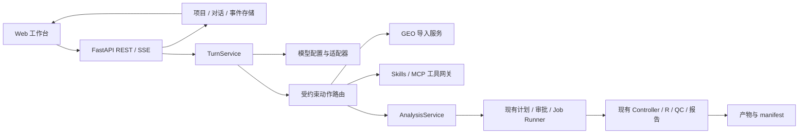

# Bio-Agent 本地研究工作台设计

**状态：** 用户于 2026-09-08 确认功能范围与实现顺序；本文将确认结果落实为工程规格。
**基线：** `agent/bio-agent-mvp` / `0b14036`；本地 Python 359 passed/1 skipped，R 37 passed。旧发布门禁仍按 current-state 记录，不能把本规格确认视为远端 CI 通过。
**交付顺序：** A 工作台与模型配置（任务 16–21）→ B GEO（22–27）→ C Skills/MCP（28–33）。每次执行一个编号任务，每三个任务整体复盘。

## 1. 范围和选择

用户选择本地 Web 工作台优先，GEO GSE 的 counts 与样本信息优先。保留文件上传、bulk RNA-seq 双组 DESeq2 和人工审批；增加对话、项目、模型配置、数据库检索和扩展工具。单个 Agent 可调用多个工具，不引入多个自主 Agent。

选择独立 React/TypeScript 前端配合已有 FastAPI：便于实现对话、事件和文件面板，并保留将来 CLI 共用同一 API 的边界。纯终端 TUI 暂不实现；桌面壳、登录/团队系统、公开部署、FASTQ 比对、多因素分析和扩展商店均不在本次交付。

三份子项目计划分别为：

- [A 工作台与模型](../plans/2026-09-08-workbench.md)
- [B GEO 数据接入](../plans/2026-09-08-geo.md)，规格见 [GEO 设计](2026-09-08-geo-design.md)
- [C Skills/MCP](../plans/2026-09-08-extensions.md)，规格见 [扩展设计](2026-09-08-extensions-design.md)

## 2. 用户界面

桌面宽度 ≥ 1200px 时采用三栏：左侧 240px 项目、对话与历史任务；中间弹性宽度显示消息、进度、澄清和审批卡片；右侧 360px 显示文件、QC、图表、报告。900–1199px 时右侧改为可开合面板，低于 900px 时侧栏为抽屉。默认中文产品文案，基因、参数、错误码和模型名保留原文。

输入区包含多行消息、附件、模型选择和发送/停止按钮。Enter 发送，Shift+Enter 换行，中文输入法组合输入不触发发送。Markdown 禁用原始 HTML，链接只接受 http/https；工具原始输出折叠，不能直接作为 HTML 渲染。

项目是任务归组，不代表任意磁盘目录访问权限。支持创建、重命名和归档项目/对话；不提供删除分析证据按钮。上传仍使用浏览器文件选择器。Streamlit 保留为旧客户端，旧 `/api/v1/runs` 和 artifact 端点继续可用。

## 3. 核心组件

- `workbench/models.py`：项目、对话、消息、turn、事件的 Pydantic 契约。
- `workbench/store.py`：独立 `workbench.sqlite`，事务、迁移、消息幂等及事件游标。
- `workbench/turns.py`：后台 turn 队列、取消、模型快照、输出落盘。
- `workbench/actions.py`：结构化动作分发，不执行模型产生的代码。
- `services/analysis.py`：从现有 routes 提取创建/读取/审批/取消服务，旧 API 与工作台共享，不能从后端请求自己的 HTTP 接口。
- `models/profiles.py`、`models/store.py`、`models/secrets.py`、`models/adapters.py`：模型配置、凭据引用和 provider 差异。
- `api/workbench_routes.py`、`api/model_routes.py`：新端点；现有 routes 不继续堆叠新模块。
- `frontend/src/`：纯 HTTP/SSE 客户端，不导入 Python，也不直接访问模型/MCP。

## 4. 持久化和状态

所有新 ID 使用 UUID。新数据库独立于 LangGraph checkpoint；不得删除、重建或悄悄迁移原有 run 目录。

| 记录 | 必需字段 |
| --- | --- |
| Project | id, title, archived, created_at |
| Conversation | id, project_id, title, archived, selected_profile_id |
| Message | id, conversation_id, role, content, dataset_ids, created_at |
| Turn | id, conversation_id, client_request_id, status, model_snapshot, run_id, error_code |
| Event | conversation_id, seq, turn_id, kind, payload, created_at |

`client_request_id` 在 conversation 内唯一；重复请求返回原 turn。单 conversation 只允许一个非终止 turn，重复发送其他请求返回 409 `TURN_BUSY`。模型调用与 R 作业使用不同后台队列，聊天不能占住现有单 R worker。

Turn 状态：QUEUED → RUNNING → WAITING_USER / COMPLETED / FAILED / CANCELLED。WAITING_USER 用于澄清、下载确认、MCP 调用确认或分析审批；必须先响应或取消，不能隐式清掉等待项。分析 run 继续使用原状态机，不把 turn COMPLETED 当成分析 COMPLETED。

事件种类：`turn.started`、`message.delta`、`message.completed`、`action.started`、`action.completed`、`action.failed`、`input.required`、`run.updated`、`turn.completed`、`turn.failed`、`turn.cancelled`。delta 是可展示答案，不展示私有推理内容。先提交事件再发送 SSE，seq 在 conversation 内递增，重连用 `Last-Event-ID` 或 `after` 重放，前端按 seq 去重；15 秒心跳不持久化。断开浏览器连接不取消工作。

模型 HTTP 连接丢失、工具有未知结果或服务重启后，未完成 turn 标记 FAILED/`TURN_INTERRUPTED`，保留部分消息，禁止自动重复付费请求或有副作用的工具调用。已获批 R 作业由现有恢复机制判定，不能仅依靠事件恢复。

## 5. 对话、动作与分析绑定

每轮加载最近 20 条完成消息（总计最多 64 KiB）、用户本轮文本、关联 dataset 摘要以及启用的能力摘要。超出限制在 UI 提示上下文截断；不把全量 counts、凭据或未选择的历史结果发给模型。

结构化 `AssistantAction` 为带 `kind` 的联合类型：

- `answer {text}`：回答软件用法和当前状态，不能捏造分析结果。
- `clarify {question}`：澄清分组/数据选择。
- `plan_analysis {dataset_id, goal}`：调用已有 AnalysisPlanner，生成原 AnalysisPlan，展示原审批卡片。
- B 阶段增加 `geo_lookup {accession}`、`geo_import {candidate_id}`。
- C 阶段增加 `mcp_call {server_id, tool_name, arguments}`。

首版每轮最多 8 次动作、120 秒主动模型/工具工作时间；等待用户不计时，超限返回 `TURN_BUDGET_EXCEEDED`。需要执行 R 的动作一律停在审批；模型文本“已批准”或 Skill 内容不是批准来源。

创建 run 时原子保存 `{conversation_id, turn_id, model_snapshot, skill_names, skill_hashes, source_id}` 的非密钥上下文；Skill 名称与组合 hash 按同一顺序保存，长度必须一致。只向 manifest 增加可选 `agent_context`，旧 manifest 仍可校验。所有路径和科学参数仍由现有服务重验。

## 6. 模型配置

Profile：`id, label, provider, model, base_url, credential_ref, structured_method, thinking, revision`。provider 首版支持 `deepseek`、`openai_compatible`、`ollama`。不同模型作为不同 profile，可设置对话默认配置。

DeepSeek 使用已实测的 function_calling + thinking disabled；Ollama 使用其原生 function_calling 接口；OpenAI 兼容服务默认 function_calling，可显式选择 json_schema。不宣称所有兼容服务支持相同参数；“测试连接”发送固定非敏感结构化探针，失败返回可操作错误码。没有模型时，仍可浏览历史、上传和使用显式固定演示，不能假装模型已连接。

用户切换模型只更新下一轮默认值。每个 turn 开始时冻结 provider/model/base_url/配置 revision/结构化方式，不保存 Key；已有 run 的计划不受切换影响。修改凭据不复用旧客户端，影响下一次请求。模型失败不自动偷偷切换 provider，用户可选择另一配置开启新 turn。

密钥通过后端操作系统凭据存储（Python keyring）保存，配置文件/数据库只保存引用，API 返回 `credential_configured` 布尔值；读取端点永不回显密钥。环境变量和现有 `.env` 作为兼容的只读凭据来源。凭据存储不可用时允许环境引用，不回退到明文 JSON 文件。禁止 `VITE_` 密钥、浏览器 localStorage 密钥、请求体日志和 MCP 凭据复用到模型。

## 7. API

新 API 使用 `/api/v1/workbench` 和 `/api/v1/model-profiles`；资源分页 limit 默认 50、最大 100，按更新时间与 ID 游标排序。

| 方法/路径 | 请求/响应 |
| --- | --- |
| POST /workbench/projects | `{title}` → 201 Project |
| GET /workbench/projects | `{items,next_cursor}` |
| PATCH /workbench/projects/{id} | `{title?,archived?}` → Project |
| POST /workbench/conversations | `{project_id,title}` → 201 Conversation |
| GET /workbench/conversations?project_id= | 列表 |
| PATCH /workbench/conversations/{id} | `{title?,archived?,selected_profile_id?}` |
| GET /workbench/conversations/{id}/messages | 完成消息与部分消息，分页 |
| POST /workbench/conversations/{id}/turns | `{client_request_id,text,dataset_ids,profile_id}` → 202 Turn |
| GET /workbench/conversations/{id}/events?after= | SSE，ID=seq |
| POST /workbench/turns/{id}/cancel | 幂等取消请求 → 202 |
| POST /workbench/turns/{id}/responses | `{request_id,action,value,revision}` → 202；旧 revision 返回 409 |
| GET/POST /model-profiles | 脱敏列表 / 创建 |
| PATCH/DELETE /model-profiles/{id} | 更新 / 删除；已有快照保留 |
| PUT/DELETE /model-profiles/{id}/credential | 写入 / 清除凭据，不回显 |
| POST /model-profiles/{id}/test | 固定探针 → `{ok,code,capabilities}` |

审批卡仍请求旧 `/runs/{id}/approval`，响应同步为 turn 事件。GET `/` 提供前端 index 或未构建的明确启动提示；`/api/...` 未知路径仍返回 JSON 404，不能落入 SPA index。

错误至少区分 MODEL_NOT_CONFIGURED、MODEL_AUTH_FAILED、MODEL_RATE_LIMITED、MODEL_TIMEOUT、MODEL_PROTOCOL_UNSUPPORTED、MODEL_OUTPUT_INVALID、MODEL_UNAVAILABLE；只暴露白名单信息，不能把 provider 原始异常直接返回 UI。

## 8. 本地服务边界

默认仅绑定 127.0.0.1。生产静态资源由 FastAPI `/` 同源提供；开发 Vite 5173 将 `/api`、`/health`、`/ready` 代理至 8000，不启用任意来源 CORS。

配置凭据和本地 MCP 进程是新增敏感能力：检查 Host；含 Origin 的请求仅接受当前本地前端 origin；新工作台修改请求必须携带同源 bootstrap 获得的随机 CSRF token，不放 URL/query，也不替代远程用户鉴权。旧 Streamlit 的无 Origin 本地请求保持兼容；不能声称这些约束支持公网部署。

消息最多 16 KiB、profile 标签 80 字、URL 2048 字；记录次数/事件查询分页受限。Markdown、SVG 和下载的 HTML 不在主页面同源执行；HTML 报告使用无脚本 sandbox iframe，CSV/PNG 通过既有 artifact ID 读取。

## 9. 技术和启动交付

Python 3.12/uv、原有 FastAPI/LangGraph/SQLite/R；前端 React + TypeScript + Vite，npm/package-lock.json，Vitest/Testing Library 和 Playwright。Node 22.12+；首次实现记录实际版本并锁定依赖，CI 用 lockfile 安装。MCP SDK 版本在 C 阶段独立锁定，避免将当前主分支示例当成固定 API。

交付 `scripts/start-workbench.ps1`：验证 Python/R/前端构建，启动一个后端并打印本地 URL；不安装系统软件、不杀占用端口进程。开发仍支持两个终端；正式构建后一次启动打开工作台。退出后端结束它拥有的队列和 MCP 子进程。

## 10. 验收和任务对应

| 验收 | 任务 |
| --- | --- |
| 项目/对话持久化、幂等 turn、游标重放 | 16,18 |
| 多 profile、脱敏、切换快照、固定探针 | 17 |
| 对话到原计划/审批/结果、取消和恢复 | 19 |
| 三栏工作台、附件、事件和设置 | 20 |
| Windows/Ubuntu 后端回归、前端测试、实际浏览器演示 | 21 |
| GSE 检索、数据选择、下载、转换和来源 | 22–27 |
| Skills/MCP 配置、可控调用和审计 | 28–33 |

所有自动模型/网络测试均用 Mock 或本地 fixture server。R 使用真实固定合成数据，覆盖 shrink 开/关。浏览器验收覆盖发送、刷新恢复、模型切换、未审批零执行、下载和失败提示。不把进度动画、HTTP 200 或工具“成功”文本当成统计完成。

## 11. 依据

- [Vite 官方入门与 Node 要求](https://vite.dev/guide/)
- [DeepSeek 工具调用](https://api-docs.deepseek.com/guides/tool_calls/)
- [GEO 下载](https://www.ncbi.nlm.nih.gov/geo/info/download.html)
- [MCP Python SDK 客户端](https://github.com/modelcontextprotocol/python-sdk/blob/main/docs/client/index.md)

这些链接用于核对接口能力；本项目对话、任务和权限设计是本规格的工程选择。
