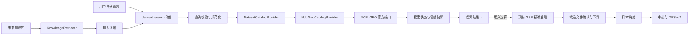

# GEO 关键词搜索、下载衔接与 RAG 扩展设计

**状态：** 已确认

**日期：** 2026-09-14

## 1. 目标

在现有“输入明确 GSE 编号 → 检查候选文件 → 人工确认下载 → 样本映射 → DESeq2”流程之前增加 GEO 关键词搜索。用户可以用疾病、组织、物种和测序类型描述目标，从 NCBI GEO 获得带来源证据的 GSE 候选，再明确选择一个候选进入已有下载和分析链路。

第一版只把符合现有 bulk RNA-seq 双组 raw counts 合约的数据送入 DESeq2。搜索可能返回其他数据类型，但界面只允许用户继续检查；精确 GSE 元数据与文件分类仍是判断是否可分析的权威步骤。

同时建立独立的知识检索接口，为以后接入 RAG 知识库保留稳定边界。本阶段不实现向量库、文档摄取、embedding 或知识库设置页。

## 2. 设计原则

1. NCBI GEO 是第一版唯一的数据目录提供者，后端只调用官方、允许列表内的 HTTPS 端点。
2. 模型把自然语言转成受约束的搜索请求，但不能提供下载 URL、文件路径或可执行代码。
3. 搜索、数据下载和知识检索是不同能力；数据目录结果不能作为统计结果，RAG 片段也不能成为 counts 输入。
4. 用户必须选择搜索结果，并继续完成现有候选文件、raw counts、样本映射和分析计划审批。
5. 查询、筛选条件、响应来源、候选选择和最终 source/run 绑定均可审计。
6. provider 接口可替换，但第一版不引入多数据库聚合和多 Agent 编排。

## 3. 方案选择

采用应用内置的 `NcbiGeoCatalogProvider`，通过 NCBI 官方检索接口获取 GSE 编号和系列摘要，再由现有 `GeoClient` 对用户选中的 GSE 做精确发现。

未采用以下方案：

- 仅通过 MCP 搜索：部署依赖外部 MCP 服务，结果契约、可用性和来源审计无法由应用统一保证。
- 让模型直接进行网页搜索：模型可能产生不存在的 GSE 或不可验证 URL，也无法稳定衔接现有下载状态机。

MCP 以后仍可提供辅助文献检索，但不会替代内置 GEO 数据目录提供者。

## 4. 总体架构



### 4.1 责任边界

- **模型：** 只生成 `dataset_search` 的结构化查询，或解释已经取得的结果。
- **DatasetCatalogProvider：** 搜索数据目录，返回受限、来源明确的候选记录，不下载文件。
- **NcbiGeoCatalogProvider：** 构造 NCBI 查询、分页读取、规范化 GSE 记录并遵守速率和大小限制。
- **GeoSearchService：** 管理搜索状态、持久化、事件、取消和候选选择。
- **GeoImportService：** 保持现有职责；只在用户选定 GSE 后执行精确元数据发现、文件分类、下载和转换。
- **KnowledgeRetriever：** 未来查询 RAG 知识库；不返回可下载数据集，也不改变分析状态。
- **前端：** 展示实际查询、筛选条件、来源、候选和错误，并要求用户点击选择。

## 5. 核心契约

### 5.1 数据目录查询

`DatasetSearchQuery` 包含：

- `text`：必填关键词，去除控制字符并限制 UTF-8 大小。
- `provider`：第一版固定为 `geo`。
- `organism`、`tissue`、`technology`：可选短文本筛选条件。
- `page_token`：后端生成的不透明分页游标。
- `page_size`：默认 10，最大 20。

模型动作名为 `dataset_search`。动作只接受上述业务字段，不接受 URL、HTTP 参数、排序表达式或本地路径。后端把查询规范化后再交给 provider。

### 5.2 搜索候选

`DatasetSearchHit` 包含：

- provider 和稳定记录 ID；GEO 中记录 ID 为合法 GSE accession。
- 标题、摘要、物种、平台、样本数、提交或公开日期。
- NCBI 官方记录 URL，由后端按 accession 构造。
- 命中证据和检索时间。
- `analysis_readiness`：`NEEDS_INSPECTION`、`UNSUPPORTED` 或 `UNKNOWN`。

搜索摘要不能证明存在 raw counts。只有用户选择后运行现有精确发现，才会产生 `RAW_COUNTS`、`NORMALIZED`、`UNKNOWN` 或 `UNSUPPORTED` 文件候选。

### 5.3 Provider 接口

```python
class DatasetCatalogProvider(Protocol):
    def search(self, query: DatasetSearchQuery) -> DatasetSearchPage: ...


class KnowledgeRetriever(Protocol):
    def retrieve(self, query: KnowledgeQuery) -> tuple[KnowledgeEvidence, ...]: ...
```

两类结果共享 `EvidenceRef`：provider、source ID、官方 URI、检索时间和内容哈希。`KnowledgeEvidence` 另外保留 document ID、chunk ID、引用标题和可选页码。接口不能返回可执行指令或把文本直接写入统计输入。

第一版依赖容器注入 `NcbiGeoCatalogProvider` 和未配置的 `NullKnowledgeRetriever`。后续接 RAG 时替换知识检索实现，并增加明确的知识搜索动作；不修改 GEO 下载、Dataset 合约或 DESeq2 执行器。

## 6. 用户流程

1. 用户输入“查找阿尔茨海默病脑组织 bulk RNA-seq 数据”。
2. 模型生成结构化 `dataset_search`，界面显示正在使用的关键词和筛选条件。
3. 后端异步搜索 NCBI GEO，并通过既有工作台事件流发布状态。
4. 界面显示分页候选，包括 GSE、标题、物种、平台、样本数、摘要和官方链接。
5. 用户点击某个候选的“检查可分析文件”。
6. 后端把该 GSE 交给现有 `GeoImportService.create_source()`；搜索动作本身不下载数据。
7. 用户在现有 GEO 来源卡中确认候选文件和 raw counts 类型，然后下载。
8. 用户映射样本、选择两组、确认比较方向并审批分析计划。
9. source provenance 保存 search ID、query hash 和 selected accession；run manifest 继续保存 source/dataset/hash 链。

用户仍可直接输入明确 GSE，跳过关键词搜索。

## 7. API 与状态

新增 API：

- `POST /api/v1/geo/searches`：创建搜索，返回 `202` 和搜索状态。
- `GET /api/v1/geo/searches/{search_id}`：读取状态与当前页结果。
- `POST /api/v1/geo/searches/{search_id}/pages`：使用服务端游标读取下一页。
- `POST /api/v1/geo/searches/{search_id}/selection`：选择一个属于该搜索 revision 的 GSE，并启动现有精确 source discovery。
- `POST /api/v1/geo/searches/{search_id}/cancel`：取消尚未完成的搜索。

状态为 `QUEUED`、`SEARCHING`、`AWAITING_SELECTION`、`SELECTED`、`CANCELLED` 或 `FAILED`。搜索 revision、query hash 和结果快照持久化；进程重启不能把未知结果标记为成功。

事件沿用对话 SSE，新增 `geo.search.updated` 和 `geo.search.selected`。事件只携带 ID、状态、revision 和计数，完整结果由 GET API 拉取。

## 8. 安全与资源边界

- 只允许 NCBI GEO 官方主机；继续使用 DNS 固定、禁用重定向、TLS、`trust_env=False` 和全局速率限制。
- 查询文本按数据处理，不拼接到命令、模板或任意 URL 中；HTTP 参数由客户端库编码。
- 限制查询字段长度、单页 20 条、单次最多 100 条、元数据总大小和总耗时。
- 搜索响应中的标题和摘要是不可信文本；前端通过现有安全 Markdown/纯文本边界展示。
- provider 错误映射为稳定错误码，例如 `GEO_SEARCH_INVALID`、`GEO_SEARCH_RATE_LIMITED`、`GEO_SEARCH_TIMEOUT`、`GEO_SEARCH_UNAVAILABLE` 和 `GEO_SEARCH_NO_RESULTS`。
- 搜索和知识证据不能创建 Dataset、修改 run、绕过下载确认或绕过分析审批。
- API Key、NCBI token 或未来 RAG 凭据不写入搜索快照、日志、事件、manifest 或模型上下文。

## 9. 前端设计

对话时间线新增搜索状态卡和候选列表：

- 顶部显示规范化查询、筛选条件、来源和检索时间。
- 每条候选显示 GSE、标题、物种、平台、样本数、摘要、官方链接和可分析状态说明。
- 主按钮为“检查可分析文件”，不会写成“立即分析”。
- 支持下一页、失败重试和取消；切换项目或对话后按服务端状态恢复。
- 选择候选后继续复用 `GeoSourceCard`、下载进度和样本映射组件。

## 10. 验证策略

遵循少而有效的验证：

1. provider 契约测试使用本地 HTTP fixture，覆盖查询编码、分页、重复 GSE、大小限制和错误映射。
2. 服务/API 测试覆盖持久化 revision、候选归属校验、选择后调用现有 source discovery，以及搜索不能直接下载。
3. Agent 测试覆盖自然语言触发 `dataset_search`、结果选择必须由用户完成，以及明确 GSE 仍走原路径。
4. 前端组件测试覆盖搜索结果展示、分页和选择动作。
5. 一个本地 Playwright 流程覆盖“关键词搜索 → 选择 GSE → 现有下载与审批链”；不访问真实公网或真实模型。
6. 完成 Task 36 时运行一次全仓 Python、前端、R 和静态检查门禁，不为简单展示逻辑重复增加测试。

## 11. 实施分段

- **Task 34：** 搜索契约、NCBI GEO provider、搜索仓库、服务和 API。
- **Task 35：** Agent 搜索动作、事件衔接、搜索结果界面和现有 source discovery 复用。
- **Task 36：** 搜索 provenance、RAG 接口、端到端验证、文档与 34–36 整体复盘。
